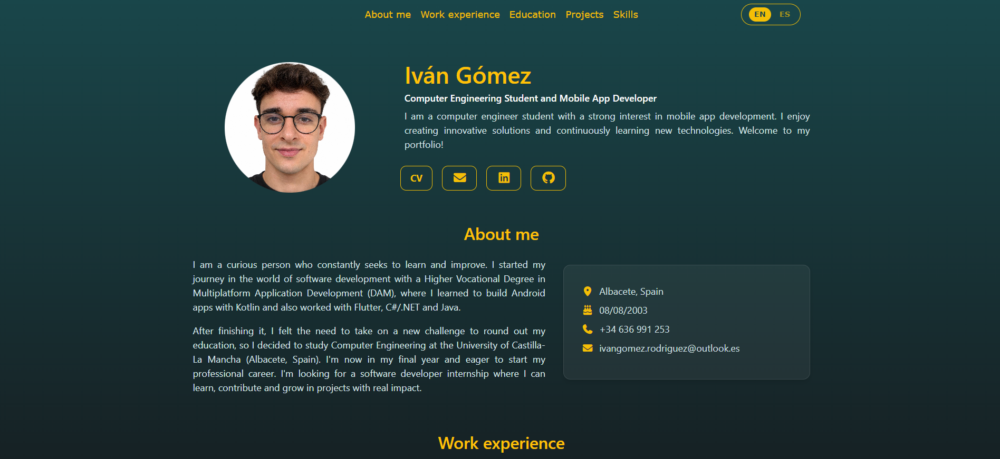
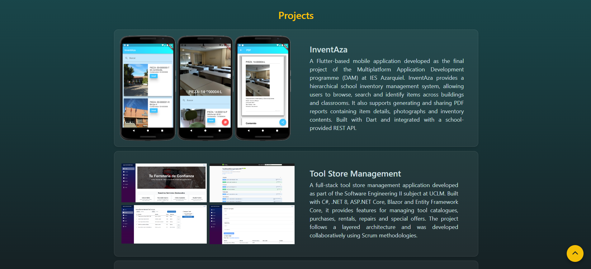
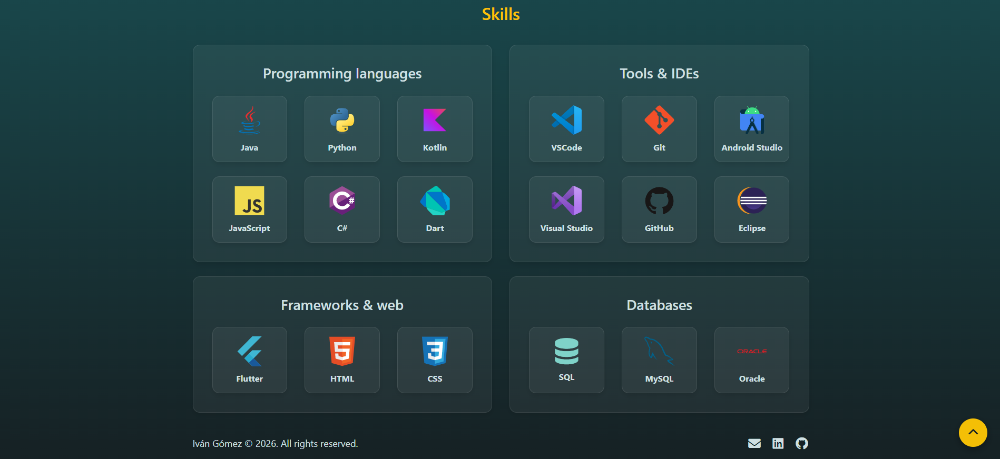

# 👨‍💻 Iván Gómez — Personal Portfolio (HTML + CSS + JavaScript)


My personal portfolio: a single-page, **bilingual (English / Spanish)** and responsive website that presents who I am, my work experience, education, projects and skills. It is built with plain HTML, CSS and JavaScript on top of **Bootstrap 4**, with no build step and no framework.

> 💼 **Personal project.** I am a Computer Engineering student at the University of Castilla-La Mancha and I am looking for a software developer internship. This portfolio is where I show my background and my work.

---

## 📸 Screenshots

| Header and about me | Projects |
|---|---|
|  |  |

| Work Experience and Education | Skills |
|---|---|
|  |  |

---

## ✨ Features

- **Single page** with five sections: About me, Work experience, Education, Projects and Skills.
- **Language switch (EN / ES)** in the top-right corner of the navbar:
  - all the visible text is translated, including the page title, `alt` texts and accessibility labels;
  - the chosen language is saved in `localStorage`, and on the first visit it follows the browser language.
- **Responsive navigation**: centered menu on desktop, and a hamburger menu on mobile with the language switch on the opposite side. Links scroll smoothly to each section.
- **Back-to-top button** at the bottom-right corner. It appears after scrolling down and takes you back to the top smoothly.
- **Projects** shown as cards with screenshots and a link to each repository.
- **Image lightbox**: click any project screenshot to see it enlarged, and close it by clicking outside the image or pressing `Esc`.
- **Skills** grouped by category (languages, tools, frameworks and databases) with their icons.
- **Contact and downloads**: downloadable CV and direct links to email, LinkedIn and GitHub.
- Custom dark theme with a yellow accent, built on top of Bootstrap.

---

## 🧰 Tech Stack

| Layer | Technology |
|---|---|
| Markup | **HTML5** |
| Styling | **CSS3** + **Bootstrap 4.3** (grid, navbar and utilities) |
| Behaviour | Vanilla **JavaScript** (no frameworks, no bundler) |
| Icons | Font Awesome 7 and Devicon (both through CDN) |
| Internationalization | Own lightweight i18n: a translations dictionary and `data-i18n` attributes |
| Dependencies | Loaded from CDNs, nothing to install |

---

## 🏗️ Architecture

A static site: one `index.html` with all the content, one stylesheet and two scripts, each with a single responsibility.

| File | Responsibility |
|---|---|
| `index.html` | Structure and content of every section |
| `css/style.css` | Theme, navbar, language switch, cards, lightbox and back-to-top button |
| `js/i18n.js` | Translations (EN / ES) and language switching |
| `js/script.js` | Image lightbox and back-to-top button |

### How the translation works

Every translatable element is marked in the HTML with a key, and `i18n.js` looks that key up in the dictionary of the selected language:

```html
<!-- Replaces the text of the element -->
<h3 data-i18n="about.title">About me</h3>

<!-- Replaces attributes (alt, title, aria-label…) -->

```

```js
const translations = {
  en: { 'about.title': 'About me' },
  es: { 'about.title': 'Sobre mí' }
};
```

`setLanguage(lang)` updates the texts, the attributes, the `<html lang>` value, the page title and the active option of the switch, and stores the choice in `localStorage`. To add a new language, create a new entry in `translations` and add a button for it in the switch.

---

## 📁 Project Structure

```
personal-portfolio/
├── index.html                  # Page structure and content
├── css/
│   └── style.css               # Custom styles
├── js/
│   ├── i18n.js                 # EN / ES translations and language switch
│   └── script.js               # Lightbox and back-to-top button
├── assets/
│   ├── Ivan_Gomez_Rodriguez_CV.pdf
│   └── img/                    # Profile photo and project screenshots
└── screenshots/                # Images used in this README
```

---

## 🚀 Running Locally

**No installation needed.** There are no dependencies to install and no build step.

### Quick preview
Open **`index.html`** directly in your browser (double-click).

### With a local server
A local server is closer to a real deployment, and `localStorage` behaves the same as in production:

1. Clone the repository:
   ```bash
   git clone https://github.com/ivangomezr/personal-portfolio.git
   cd personal-portfolio
   ```
2. Start a server, for example with Python:
   ```bash
   python -m http.server 8000
   ```
   Or use the **Live Server** extension in VS Code, which reloads the page on every save.
3. Open `http://localhost:8000`.

> ℹ️ Bootstrap, Font Awesome, Devicon and the skill icons are loaded from CDNs, so an internet connection is required.

---

## 🙋 Author

**Iván Gómez** — [@ivangomezr](https://github.com/ivangomezr)

Computer Engineering student at UCLM and mobile app developer.
